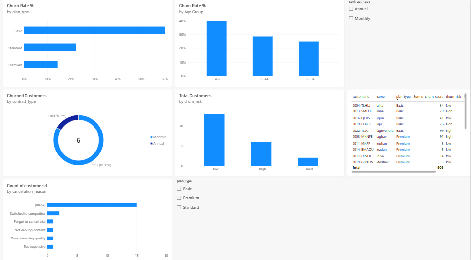

# 📊 Customer Churn Analysis & Retention Intelligence

An end-to-end data analytics project that uncovers the structural, behavioral, and operational drivers of subscription churn using **Python, Pandas, Matplotlib, Seaborn, and Power BI**.

---

## 📊 Power BI Dashboard



- 📄 [View the dashboard as PDF](powerbi/Churn_Dashboard.pdf)
- 📥 [Download the Power BI file (.pbix)](powerbi/Churn_Dashboard.pbix)

---

## 📌 Executive Summary

Customer acquisition costs far outpace retention costs. This project analyzes subscription churn across customer demographics, plan tiers, and support service logs to find out why users leave and to identify early warning signals for proactive retention.

| Metric | Value |
|---|---|
| Churn Rate | **28.57%** |
| Retention Rate | **71.43%** |
| Average Revenue Per User (ARPU) | **$18.85** |
| Monthly Revenue at Risk | **$73.94k** |
| Escalations vs. Churn Correlation | **0.77** (strong positive) |

---

## 🔍 Key Business Findings

**1. The Basic Tier Value Gap**
- Basic: **60.00%** churn, Standard: **22.22%**, Premium: **14.29%**
- Feedback logs point to content scarcity and a pricing mismatch relative to the value delivered.

**2. Support Escalations Predict Churn**
- Customers with escalated tickets (`escalations == 'Y'`) churned at **100%**.
- Average CSAT score: **31.7 / 100** for churned users vs. **90.0 / 100** for retained users.

**3. Contract Commitment Matters**

| Contract | Churn Rate | Avg. CLTV |
|---|---|---|
| Monthly | 55.6% | $308.56 |
| Annual | 8.3% | $1,209.75 |

---

## 💡 Recommendations

- Redesign or reprice the Basic tier, and add more content or features to justify the cost.
- Treat every escalated ticket as a high churn risk and give it priority resolution and follow-up.
- Offer incentives (discounts, bonus features) to move Monthly subscribers to Annual plans.
- Track CSAT as an early warning metric and trigger outreach when scores drop.

---

## 🏗️ Project Pipeline

```
Raw Data Ingestion (Excel, 3 sheets)
        ↓
Data Audit & Quality Checks (NaNs, categorical inconsistencies, datatypes)
        ↓
Feature Engineering (age cohorts, churn risk, escalation flags)
        ↓
Exploratory Data Analysis (plan tiers, contract terms, geography)
        ↓
Correlation & Heatmap Analysis
        ↓
Power BI Dashboard & Retention Strategy
```

---

## 🛠️ Tech Stack

| Category | Tools |
|---|---|
| Language | Python |
| Data Manipulation | Pandas, NumPy |
| Visualization | Matplotlib, Seaborn, Power BI |
| File Handling | OpenPyXL, Excel |
| Environment | Jupyter Notebook |

---

## 📁 Repository Structure

```
customer-churn-analysis/
├── images/
│   └── powerbi_dashboard.png        # Dashboard screenshot
├── powerbi/
│   ├── Churn_Dashboard.pbix         # Power BI file
│   └── Churn_Dashboard.pdf          # Dashboard export
├── customer_churn_data_raw.xlsx     # Raw dataset
├── final_cleaned_data.xlsx          # Cleaned dataset
├── data_analysis.ipynb              # Cleaning, EDA & correlation analysis
├── data_analysis.pdf                # Notebook export
├── requirements.txt                 # Python dependencies
└── README.md
```

---

## 🚀 How to Run Locally

1. Clone the repository
```bash
   git clone https://github.com/mohammadraheem786/customer-churn-analysis.git
   cd customer-churn-analysis
```

2. Create and activate a virtual environment
```bash
   python -m venv venv
   # Windows
   venv\Scripts\activate
   # macOS/Linux
   source venv/bin/activate
```

3. Install dependencies
```bash
   pip install -r requirements.txt
```

4. Launch the notebook
```bash
   jupyter notebook data_analysis.ipynb
```

To explore the dashboard, open `powerbi/Churn_Dashboard.pbix` in Power BI Desktop.

---

## 👤 Author

**Mohammad Raheem**
📧 mohammadraheem359@gmail.com | 🔗 [GitHub](https://github.com/mohammadraheem786)